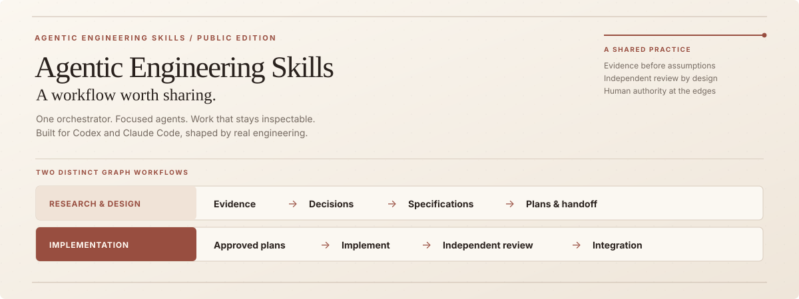
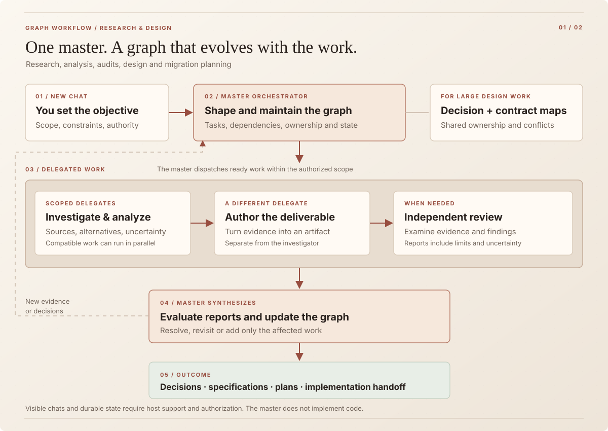
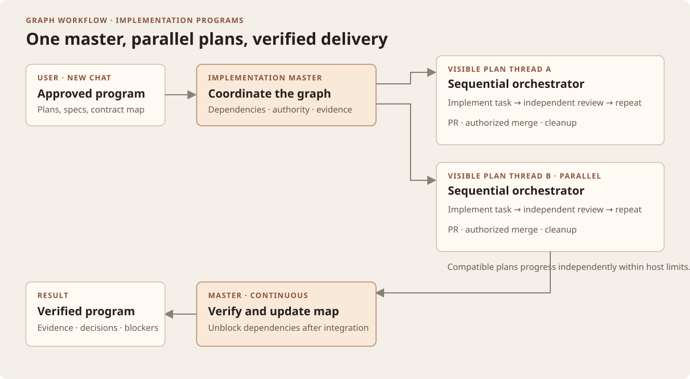
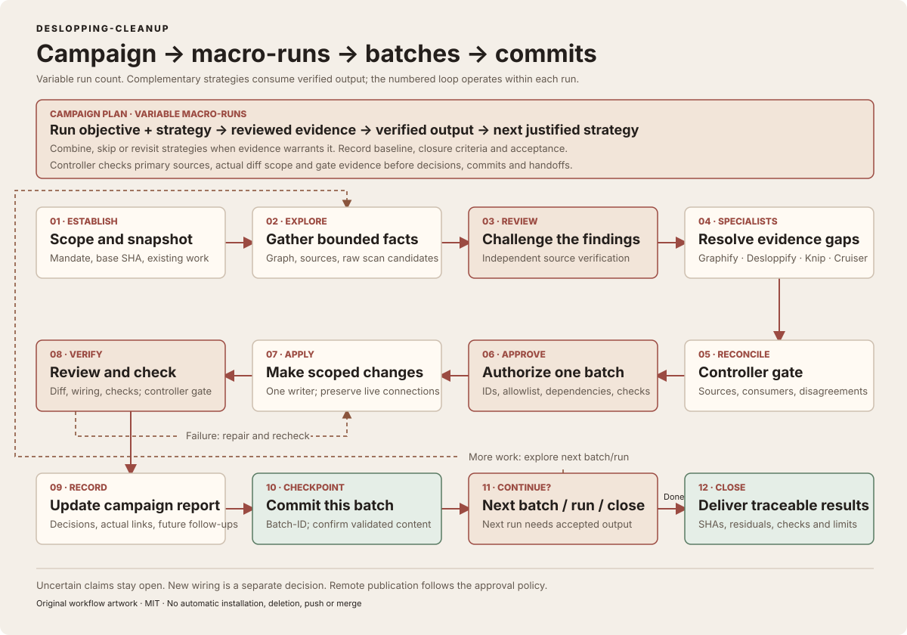
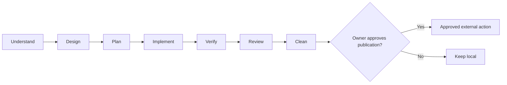

# Agentic Engineering Skills



I share this experience-shaped workflow from hands-on engineering work: one master orchestrator coordinates a graph of focused work, while specialist agents and sessions carry each task forward.

## What this repository shares

This repository shares composable skills for Codex and Claude Code, organized around a master orchestrator. Start a conversation with the master, describe the outcome and constraints, and let it coordinate the work across a changing graph of scoped tasks, delegates, and decisions. The research and design master and the implementation-program coordinator support two complementary graph workflows. Reasoning, dependencies, evidence, and ownership stay visible enough to inspect and adapt in another project.

## My working philosophy

I start from evidence instead of an implementation guess, then turn decisions into durable specifications and traceable plans. I isolate implementation work, keep worker output separate from independent evidence, and use two quality dimensions: whether delivery remains faithful to its plan and whether implemented behavior is correct. Publication and other external actions stay under explicit owner control; a plan or passing test suite does not grant publication permission.

Vendor files remain byte-exact, adaptations stay auditable, and repository-original files use this repository's MIT license. Third-party assets keep their own terms even when bundled in an MIT-licensed skill. [Workflow philosophy](docs/philosophy.md) records lifecycle gates, handoff evidence, optional-tool fallbacks, and human authority boundaries.

## How to set up a new project

Before using the workflow in a new repository, give agents a small, reliable entry point to the project's knowledge. Add an `AGENTS.md` at the repository root. Keep it extremely short: include only cross-cutting instructions that matter broadly, and point to the project documents agents should consult for each kind of task. Links tell agents where to look; linked documents are not automatically loaded into context.

A possible starting layout:

```text
AGENTS.md                      # Short instructions and map for agents
README.md                      # Project overview and entry point for people
docs/
  development/
    CODING_STANDARDS.md        # Shared engineering conventions
    BACKEND.md                 # Backend-specific guidance, if applicable
    FRONTEND.md                # Frontend-specific guidance, if applicable
  architecture/
    OVERVIEW.md                # System boundaries and major components
    adr/                       # Important decisions and their status
  operations/
    LOCAL_SETUP.md             # Prerequisites, setup and local execution
    DEVELOPMENT_OPERATIONS.md  # Verification and development procedures
  work/
    specs/                     # Approved requirements and designs
    plans/                     # Implementation plans and progress
    reports/                   # Verification results and historical evidence
```

Create `AGENTS.md` in the root of your project and use it as the short entry point to your documentation. For example, if the guides above exist in your project, the contents of `AGENTS.md` could be:

```markdown
# Project instructions

- Project overview: read `README.md`.
- Shared conventions and verification: read `docs/development/CODING_STANDARDS.md`.
- Service boundaries and decisions: read `docs/architecture/OVERVIEW.md` and the relevant ADRs `docs/architecture/adr/`.
- Local setup: read `docs/operations/LOCAL_SETUP.md`.
```

Use only the files your project needs and adapt their names and structure. Keep each rule or decision in one authoritative place, and link to it from the short entry point. Do not create empty documents merely to match this example.

For a file-by-file explanation, how to decide what belongs where, and host-specific setup, see [project context and instructions](docs/workflow.md#project-context-and-instructions).

## Graph workflows

A graph workflow starts with a **new chat and an explicit orchestration skill**. Give the master the objective, scope, expected result, constraints, and existing instructions. It sets up the run from that context: nodes, dependencies, responsibilities, and completion criteria evolve as the work reveals new questions. You keep the conversation with the master while it coordinates focused subagents and, when supported and authorized, separate sessions or subthreads.

These are task and decision graphs. Graphify's semantic codebase graph can supply evidence to a delegated investigation; it is a separate tool and is not required to run the master.

### When Graphify is useful

Consider Graphify when a large codebase makes an agent spend substantial time and tokens finding files and their relationships. As a rough guideline, maintaining a codebase graph is often inefficient below 100,000 lines of code; above that scale, evaluate whether faster discovery outweighs the cost of building and updating it. This is a heuristic, not a hard threshold.

### Research, analysis, and design

In a fresh Codex chat, explicitly invoke `$master-orchestrator`. In Claude Code, select the installed `master-orchestrator` skill explicitly. The [skill](plugins/agentic-engineering-skills/skills/master-orchestrator/SKILL.md) covers non-implementation work: repository study, research, audits, design, and migration planning.

The master keeps the run's objective, state, decisions, and dependencies in view. Delegates inspect sources and return filtered, attributable findings; a different delegate authors the deliverable, with independent review when needed. The master evaluates the reports and updates the graph, adding or revisiting nodes as evidence changes. Human decisions pause their dependent nodes while unrelated work can continue. Creating visible chats, using trackers, and preserving resumable state depend on the host's capabilities and the user's authorization.

For larger design programs, the master also maintains a map of decisions and a separate map of shared contracts. It coordinates authorized streams, ownership, amendments, and unresolved conflicts before delivering specifications, plans, or an implementation handoff. The master itself does not implement code.



### Implementation programs — available

In a new chat, explicitly invoke [`coordinating-implementation-plans`](plugins/agentic-engineering-skills/skills/coordinating-implementation-plans/SKILL.md) with the approved contracts map, plans, specifications, constraints and authorizations. The master coordinates dependencies and compatible plans in parallel; a dependency is ready only when the required revision is available on its target.

Each plan has a visible subordinate thread using `plan-orchestrator`, which creates a `task-implement` thread followed by a separate review thread for each dependency-ready task. Independent tasks may overlap only in isolated workspaces with disjoint ownership and a defined integration order. The plan thread owns its PR lifecycle and authorized merge and cleanup; the master verifies evidence, maintains the contract map and unblocks dependent work. If the host cannot create the required visible threads, the workflow reports a block. For a single plan, invoke `plan-orchestrator` directly.



## How I use the workflow

The master selects relevant specialist routes within the authorized scope. These are composable choices, not mandatory stages for every task; existing implementation routes remain usable directly.

| Situation | Path | Purpose |
| --- | --- | --- |
| Research, analysis, audit, or design program | `Master Orchestrator` | Coordinate a dynamic graph of delegated non-implementation work. |
| Large, uncertain initiative | `Wayfinder` | Map scope that reaches beyond one session when useful and available. |
| Outcome-driven native Goal run | `Setup Goal` | Agree the outcome, constraints, and metrics, save a runbook, then request confirmation to launch the host's native Goal. |
| Bounded or creative design | `Brainstorming` | Clarify intent before changes. |
| Consequential or disputed design | `Grill-me` | Pressure-test assumptions. |
| Agreed design | `To Spec` | Create standalone specification. |
| Multi-step implementation | `Writing Plans` | Create traceable implementation plan. |
| Implementation program with multiple approved plans | `Coordinating Implementation Plans` | Coordinate compatible plan threads in parallel and track dependencies. |
| One implementation plan | `Plan Orchestrator` | Dispatch dependency-ready tasks, each with separate implementation and review threads. |
| Small implementation | `Task Implement` | Implement one assigned plan task, coordinate bounded subtasks, and verify its acceptance criteria. |
| Claude Code implementation | `Task Implement` | Use the same shared task workflow with Claude-specific model routing. |
| Repository cleanup across responsibilities | `Deslopping Cleanup` | Investigate candidates, review evidence, and commit verified cleanup batches. |

Explicitly invoke [`setup-goal`](plugins/agentic-engineering-skills/skills/setup-goal/SKILL.md) when you want to prepare a native Goal run. It co-designs the outcome, constraints, and progress metrics, then saves `runbook.md` with those three sections. Review the saved runbook and exact Goal condition before giving final confirmation to start that version. Only then does it activate the host's native Goal; agreeing individual sections does not start execution. If the host has no native Goal capability, the runbook remains ready and activation is reported as blocked.

See [workflow guide](docs/workflow.md) for routing detail.

## The quality loop

For ordered work, `Test-Driven Development` checks plan fidelity, requirement coverage, and implementation correctness through failing tests, implementation, and passing tests. Findings return through the TDD fix cycle before acceptance, then independent evidence informs review.

The [PR lifecycle hooks](#hooks-i-use) keep the next quality or cleanup action visible at the point where it is needed, while the agent performs it under the receiving project's rules.

## Hooks I use

I use two optional `PostToolUse` hooks to bring code quality and repository hygiene back into the conversation after a successful GitHub action. Their purpose is to reduce avoidable slop in merged changes and prevent completed branches and worktrees from accumulating.

The Caveman startup hooks also load its communication rules into new sessions and subagents, subject to host support and hook approval. If a project already supplies the same context, both hooks can run.

| Hook | When it activates | What it asks the agent to do |
| --- | --- | --- |
| After PR creation | A successful `gh pr create` call reported by `Bash`, or a supported GitHub MCP create-PR call; in both cases, the tool result must contain a valid GitHub PR URL. | After CI and independent review pass on the current head, run the bundled preflight verifier; only when it returns READY, run `cleaning-repo-with-knip` first on the PR changes: verify references, compatibility, and retention decisions before applying authorized safe fixes; leave out-of-scope findings as follow-ups. Then run `simplify` for behavior-preserving simplifications; recheck the final head and record the checks and fixes with the `pr-skills:v1` reporting instructions; verify the marker with the bundled checker. |
| After merge | A recognized successful `gh pr merge` call with an explicit PR number or URL, reported by `Bash`, followed by a positive read-only GitHub check that the PR is merged and has merge metadata. | Verify the merge, apply the documented Graphify refresh where applicable, inspect branch and worktree ownership and remaining work, then perform only authorized cleanup while preserving anything uncertain. |

The PR reminder makes cleanup and simplification part of finishing the change, rather than leaving them as forgotten follow-ups. The post-merge reminder prompts the agent to verify the result and, when authorized, clean up the development workspace. Both hooks add context: they do not run the skills, edit files, commit, publish, or delete branches or worktrees themselves, and they do not guarantee that the suggested work happens.

Both scripts need Node.js 22 or newer. The post-merge reminder requires an authenticated GitHub CLI (`gh`) on `PATH` and successful merge verification. The post-PR reminder only uses `gh` to enrich the message with the head branch: a valid PR URL can still produce the reminder if `gh` is unavailable or the branch lookup fails. They only observe supported tool events and recognized command/result shapes, so merges or PRs created through other paths may produce no reminder. Codex requires the plugin hooks to be reviewed and trusted before a fresh session; Claude Code also needs the plugin and hook configuration enabled. The [plugin hooks guide](docs/plugin-hooks.md) documents setup, detection, deduplication, and coverage limits.

## Supporting skills

I use `Impeccable` and `UI UX Pro Max` for frontend craft and design support, `Caveman` to compress communication and save tokens without losing technical substance, and `How to Use Codex` for current official guidance on model-aware prompting, settings, and delegation. `Improve Codebase Architecture` helps me identify where modules lack depth or locality, so I can choose focused refactors that improve leverage and testability. The post-merge reminder routes verified merge and workspace cleanup through the receiving project's approval and ownership rules.

### Deslopping Cleanup

[`deslopping-cleanup`](plugins/agentic-engineering-skills/skills/deslopping-cleanup/SKILL.md)
coordinates behavior-preserving repository cleanup as a campaign of macro-runs,
coherent batches and recoverable commits. Run count and strategy order follow
evidence gaps: each cumulative run consumes the preceding verified output and
answers a complementary question. Explorers gather facts; independent reviewers
challenge them; the controller directly checks decisive source claims, consumer
links, diff scope and gate evidence before approving the technical conclusions. Before batch approval, every proposed file/action receives its own rationale, evidence, expected wiring impact and uncertainty in the run report. Each verified batch updates a cumulative report of
removed, retained and deferred components and their actual or intended connections,
then receives its own local commit before the next batch starts. The campaign
report records run baselines, closure/acceptance criteria, controller verdicts and
handoffs; new residuals can justify another run without prescribing a fixed count.

The skill also helps determine whether a component is superseded, belongs to an
older implementation, or still serves a current or planned responsibility. It
combines semantic inference with source and history checks, actual consumers,
replacement behavior, compatibility requirements and intended functionality.
Before classifying disconnected components, it asks the owner which reference
documents describe that intent and which are authoritative and current, then
compares them with actual wiring. This adds context to static findings and makes
removal, retention and deferral proposals more precise and easier to judge.

An older name or a newer alternative alone does not establish obsolescence;
disconnected code may be a new feature deliberately awaiting integration.
Unresolved intent remains deferred rather than being presented as safe to remove.

Removals need at least two independent kinds of evidence, such as static analysis,
reference search, history, flow tracing or runtime observation, and no unresolved
counterproof. After discovery, the campaign can continue with branch integration
(conflict inventory, per-area decisions, completeness and semantic-conflict
checks), operational residue (configuration, stored data, external artifacts and
deployments, each non-file action separately approved) and workspace closure
(inventory of unique work, including ignored files, before any deletion).



Specialists remain distinct. `cleaning-repo-with-knip` and `graphify` are included.
Desloppify, Dependency Cruiser and the named external dispatch/review capabilities
remain optional, with explicit fallbacks; the bundle does not install those
external tools or load them automatically. Graphify supplies a semantic evidence
graph, separate from the master's task and decision graph. See [availability and license review](docs/deslopping-cleanup.md)
and the skill's [specialist routing](plugins/agentic-engineering-skills/skills/deslopping-cleanup/references/specialist-routing.md).

### Implementation routes

The diagram below shows the shared lifecycle of delivery responsibilities. The
master coordinates non-implementation nodes according to scope and uncertainty;
implementation is handed off to an appropriate, authorized execution route.

For a large change spanning multiple modules, I start with `Master Orchestrator`
to coordinate discovery and design, using `Wayfinder` when useful and available.
After the agreed design and plan are ready, an authorized handoff can use
`Plan Orchestrator` to dispatch one implementation thread and one review
thread per task.

For a small, well-understood change represented by one plan task, I use `Task Implement` directly, retaining
the relevant TDD, verification and owner-approval gates.

## Workflow at a glance

This diagram is the canonical overview of delivery responsibilities. A graph run can branch or revisit work within the relevant stages; the diagram does not prescribe one chat per stage.



## Install

Install complete bundle. This is supported path.

Codex:

```text
codex plugin marketplace add GiuseppeVe/agentic-engineering-skills
codex plugin add agentic-engineering-skills@agentic-engineering-skills
```

Claude Code:

```text
claude plugin marketplace add GiuseppeVe/agentic-engineering-skills
claude plugin install agentic-engineering-skills@agentic-engineering-skills
```

Confirm discovery with `codex plugin list --available --json` or `claude plugin list`. Then start a fresh host session and invoke one included skill, such as `brainstorming`; plugin listing alone does not prove fresh-session invocation.

Enable and trust the plugin hooks separately from skill installation; see [Hooks I use](#hooks-i-use) for their triggers and prerequisites.

Role attachments and native-agent registrations are separate. Implementation session profiles require explicit local setup; see the relevant implementation skill for its role and routing requirements.

The plugin exposes 35 shared skills to both Codex and Claude Code. `task-implement` selects model and effort for its orchestrator and implementation subagents according to the host.

Selective copying is advanced and can remove workflow stages. See [selective installation](docs/selective-install.md).

## Why version 1.1

This release improves graph workflows: instead of managing one chat at a time, I start with a master orchestrator that coordinates the work.

For research and design, the master delegates focused investigations and brings the results together. For implementation, a second master coordinates approved plans, running compatible plan threads in parallel while each plan handles its tasks and reviews in sequence.

Version 1.1 also adds PR lifecycle hooks. They remind the agent to run Knip and Simplify after the required checks and review, then verify the merge and clean up the development environment. The goal is to keep merged code focused and the repository clean as work accumulates.

## Customize

Fork repository and edit source files, never generated plugin cache. Full workflow: [customization guide](docs/customization.md).

## Compatibility

Bundle targets exactly two verified hosts: Codex and Claude Code. Release-specific validation evidence belongs in `docs/release-report.md`. See [compatibility](docs/compatibility.md).

## Provenance

Every skill is classified as `vendor`, `adapted`, or `original`, with hashes and pinned revisions in lock. See [provenance inventory](docs/provenance.md).

## License

Repository-original material: [MIT](LICENSE), copyright GiuseppeVe. Upstream MIT terms cover only the upstream works they license; bundled assets can carry separate restrictions. Archify's MIT license covers its code, while bundled artwork includes CC-BY-NC-SA-4.0 Vue artwork, CC-BY-SA artwork, and an SIL OFL 1.1 font. Review [Third-Party Notices](THIRD_PARTY_NOTICES.md) and the [pinned Archify asset notice](plugins/agentic-engineering-skills/licenses/tt-a1i-archify-THIRD_PARTY_NOTICES) before reuse. Forking, editing, removal, and redistribution remain subject to all applicable terms.
