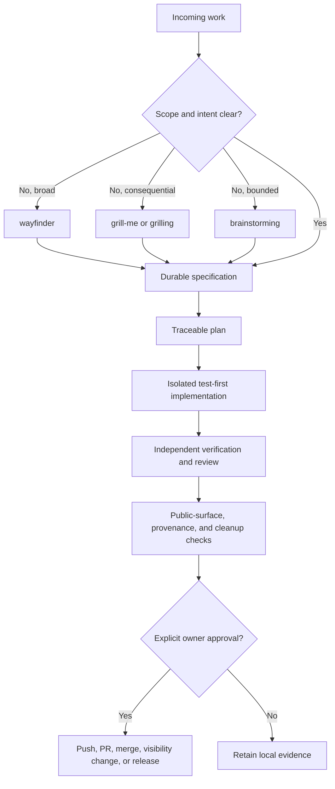

# Workflow

A new chat explicitly invoking `master-orchestrator` starts the available non-implementation graph workflow. The master turns the request into ready, scoped nodes, delegates investigation and deliverables to distinct agents, and updates dependencies and decisions from filtered reports. For large design programs it also maintains decision and contract maps through its conditional `coordinating-design` reference. User-visible child chats and persistent state require host capability and authorization. For an approved implementation program, invoke `coordinating-implementation-plans` in a new chat: it dispatches visible plan threads using `plan-orchestrator`, coordinates dependencies and integration, and respects host capability and authorization. A single plan can use `plan-orchestrator` directly. This task graph is distinct from Graphify’s semantic codebase graph.

Seven phases form a composable path. Not every skill runs on every task; choose only skills matching risk and scope. The [workflow philosophy](philosophy.md) defines decision gates, required evidence, optional-tool fallbacks, and owner authority over publication.

This guide is the relevant-stage backlink and conditional routing surface for every included public skill. Each skill appears under the phase where it can contribute; its presence is an option, not a mandate. Select it only when task scope, risk, and the philosophy's evidence gates justify that route.

## Project context and instructions

A workflow skill describes a reusable process; project instructions and documentation provide the local facts, constraints and decisions that process needs. Review existing documentation first, then introduce only what is missing. Arrange links by the work that requires them, so agents can select relevant material without reading the entire documentation tree for every task.

### Entry points

- `AGENTS.md`: Keep the repository-wide entry point short. State genuinely cross-cutting working rules, then describe which documents to consult for each relevant task. Include operational boundaries or verification pointers when these are important across the project. Avoid duplicating full policies.
- `README.md`: Explain the product, prerequisites and starting points for people and agents; link to authoritative guides instead of repeating them.
- For Codex, check the [AGENTS.md discovery and precedence rules](https://learn.chatgpt.com/docs/agent-configuration/agents-md) and verify what was loaded in a fresh session. Recent Claude Code versions can read `AGENTS.md` directly, depending on configuration and the presence of `CLAUDE.md`; where needed, a `CLAUDE.md` can import it with `@AGENTS.md`. Consult [Claude Code's instruction-loading documentation](https://code.claude.com/docs/en/memory#agents-md) and verify your session. Do not assume the two hosts discover files identically.

### Development guidance

- `CODING_STANDARDS.md`: Record shared coding conventions, repository workflow and relevant verification expectations. Keep one canonical location for each rule and link to tools or procedures for details.
- `BACKEND.md` and `FRONTEND.md`: Describe area-specific boundaries, entry points, conventions and checks when those areas exist. Split or combine guides according to project size.

### Architecture and decisions

- `OVERVIEW.md`: Map key components, responsibilities and dependencies. Explain where to find the code and more detailed decisions without duplicating implementation details.
- `adr/`: Record significant architectural decisions, their context, consequences and status. Supersede or update decisions explicitly when they change; identify which accepted decisions still constrain work.

### Operations and current work

- `LOCAL_SETUP.md`: Describe prerequisites and reproducible steps to start the project locally. Note environment limitations and which instructions were actually verified.
- `DEVELOPMENT_OPERATIONS.md`: Record available tests, checks and development procedures, including prerequisites and how to interpret results. Keep commands current with the repository.
- `specs/`: Capture the intended behavior, scope and acceptance criteria of significant changes.
- `plans/`: Translate approved work into implementation steps, dependencies and verification; distinguish planned work from shipped behavior.
- `reports/`: Record what was actually checked, the relevant revision or environment, results and limitations. Historical evidence does not by itself establish current behavior.

### Keep the map useful

Add or refine instructions when a recurring project-specific need is observed. Remove obsolete pointers, resolve contradictions, and keep linked documents current with code and configuration. Validate that links resolve and that the relevant host sees the intended entry point. For representative tasks, check whether agents find and use the right documents; revise instructions that add overhead without helping.

## Understand

`learn-codebase` builds broad project context. `graphify-start` routes codebase questions through the project Graphify protocol when present, then `graphify` can build and query a persistent knowledge graph. `ask-matt` routes a situation to an available skill or flow. `brainstorming` clarifies intent before creative changes. `grill-me` and `grilling` pressure-test uncertain proposals. `caveman` keeps collaboration compact.

Before adopting Graphify, weigh its indexing and upkeep costs against the time and tokens spent finding code. The [README guidance](../README.md#when-graphify-is-useful) treats 100,000 lines as a rough heuristic, not a requirement.

## Design

`domain-modeling` sharpens vocabulary and boundaries. `codebase-design` deepens module interfaces. `improve-codebase-architecture` finds structural opportunities. `archify` creates checked diagrams and explainers from requirements or repository evidence. `impeccable` and `ui-ux-pro-max` guide frontend visual, interaction, accessibility, and design-system decisions. `marketing-screenshots` captures real product UI for inspectable marketing assets. `writing-for-agents` shapes skills, agent instructions, and referenced documents.

## Plan

`wayfinder` maps work larger than one session. `to-spec` captures agreed behavior. `handoff` saves a compact continuation document when work moves between agents. `how-to-use-codex` turns Codex prompting and model-choice needs into current, evidence-based guidance. `writing-plans` turns requirements into testable implementation tasks and offers `plan-orchestrator` for dependency-aware multi-task execution. `setup-goal` turns an agreed outcome into a runbook and activates the host-native Goal only after approval.

## Implement

Repository instructions determine worktree isolation and merge approval. The post-merge hook reminds the agent to verify the merge, apply the documented Graphify refresh where applicable, and inspect ownership before workspace cleanup. `test-driven-development` drives red-green-refactor. `task-implement` implements one assigned plan task, coordinates bounded implementation subtasks, and verifies task acceptance criteria. `plan-orchestrator` dispatches dependency-ready tasks through an implementation thread and then a separate review thread per task; reviewers fix in-scope findings and commit only with authority. Independent tasks overlap only in isolated workspaces. The shared `task-implement` skill specifies GPT-6.1 Sol/high with GPT-6.1 Terra/high subagents for Codex, and Sonnet 5.5/high with Sonnet 5.5/medium subagents for Claude Code. Authorized multi-agent work uses the host's available delegation tools and repository routing. `orchestrating-gemini-workers` assigns small independent file tasks to sandboxed Gemini workers through `dsh` when required tooling is available.

## Verify

For new behavior and bug fixes, `test-driven-development` requires an observed behavioral failure before implementation and passing tests afterward. For refactoring or behavior already implemented, follow its coverage and recovery guidance. `mdx-to-html` creates standalone review pages from explicit MDX inputs. `setup-harness-evaluation` and `setup-workflow-comparison` collect independent run evidence for the user’s manual evaluation.

## Review

`plan-orchestrator` creates the separate task review thread; `task-implement` performs implementation and task-scoped verification only. `grill-me` or `grilling` can challenge consequential design decisions before publication. `retro` guides a retrospective after a coding session.

The post-PR hook depends on `simplify` to review the PR diff for behavior-preserving cleanup. It checks quality concerns such as reuse, efficiency, and abstraction level; it does not replace correctness review.

## Clean

`cleaning-repo-with-knip` removes verified dead code and records false positives. `plan-orchestrator` keeps implementation output separate from review fixes and accepted task commits; clean temporary artifacts and debug residue before the plan PR gate.

`deslopping-cleanup` coordinates a cleanup campaign through complementary macro-runs and coherent batches. Independent reviewers check exploration claims and batch diffs; the controller checks decision-bearing source evidence before selecting batches, actual diffs and check evidence before committing, and the verified output baseline before run handoff. Before batch approval, the controller presents a separate justified proposal for every file/action, including evidence, expected behavior or wiring impact and uncertainty. Incomplete proposals block approval; material changes require renewed approval of the affected proposal. Each approved, verified batch updates its run report and receives a separate local commit before the next batch. Missing required evidence keeps the candidate uncertain or its batch open; publishing and merging follow repository approval gates. After discovery, the campaign can continue with branch integration, operational residue and workspace closure, where every action outside files needs its own owner approval. See [dependencies and publication review](deslopping-cleanup.md).

## Routing and evidence gates

Optional integrations strengthen these stages but never become hidden dependencies. If orchestration, worktrees, GitHub CLI, browser tooling, Graphviz, or Knip is unavailable, use a documented manual fallback in the [workflow philosophy](philosophy.md) only where the selected workflow permits it, and report what actually ran. A workflow requiring visible subordinate threads is `BLOCKED` if the host cannot create them.

## Implementation role routing

`task-implement` is a shared skill with host-specific model guidance in its opening lines: GPT-6.1 Sol/high for Codex orchestration and GPT-6.1 Terra/high for its subagents; Sonnet 5.5/high for Claude Code orchestration and Sonnet 5.5/medium for its subagents. Its packet contract routes a dedicated architecture-sensitive or integration packet to GPT-5.6 Sol/medium on Codex and Opus 5.5/medium on Claude Code, or retains it with the controller. `plan-orchestrator` reads the opening lines when dispatching each implementation thread. Effective model routing remains subject to host support.

Return to [README](../README.md).
