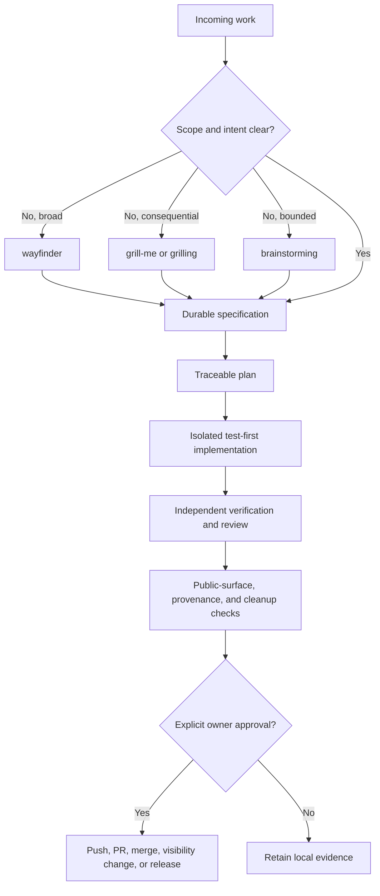

# Workflow

A new chat explicitly invoking `master-orchestrator` starts the available non-implementation graph workflow. The master turns the request into ready, scoped nodes, delegates investigation and deliverables to distinct agents, and updates dependencies and decisions from filtered reports. For large design programs it also maintains decision and contract maps through its conditional `coordinating-design` reference. User-visible child chats and persistent state require host capability and authorization. For an approved implementation program, invoke `coordinating-implementation-programs` in a new chat: it dispatches visible plan threads using `sequential-task-orchestrator`, coordinates dependencies and integration, and respects host capability and authorization. A single plan can use `sequential-task-orchestrator` directly. This task graph is distinct from Graphify’s semantic codebase graph.

Seven phases form a composable path. Not every skill runs on every task; choose only skills matching risk and scope. The [workflow philosophy](philosophy.md) defines decision gates, required evidence, optional-tool fallbacks, and owner authority over publication.

This guide is the relevant-stage backlink and conditional routing surface for every included public skill. Each skill appears under the phase where it can contribute; its presence is an option, not a mandate. Select it only when task scope, risk, and the philosophy's evidence gates justify that route.

## Understand

`learn-codebase` builds broad project context. `graphify-start` routes codebase questions through the project Graphify protocol when present, then `graphify` can build and query a persistent knowledge graph. `ask-matt` routes a situation to an available skill or flow. `brainstorming` clarifies intent before creative changes. `grill-me` and `grilling` pressure-test uncertain proposals. `caveman` keeps collaboration compact.

Before adopting Graphify, weigh its indexing and upkeep costs against the time and tokens spent finding code. The [README guidance](../README.md#when-graphify-is-useful) treats 100,000 lines as a rough heuristic, not a requirement.

## Design

`domain-modeling` sharpens vocabulary and boundaries. `codebase-design` deepens module interfaces. `improve-codebase-architecture` finds structural opportunities. `archify` creates checked diagrams and explainers from requirements or repository evidence. `impeccable` and `ui-ux-pro-max` guide frontend visual, interaction, accessibility, and design-system decisions. `marketing-screenshots` captures real product UI for inspectable marketing assets. `writing-for-agents` shapes skills, agent instructions, and referenced documents.

## Plan

`wayfinder` maps work larger than one session. `to-spec` captures agreed behavior. `handoff` saves a compact continuation document when work moves between agents. `how-to-use-codex` turns Codex prompting and model-choice needs into current, evidence-based guidance. `writing-plans` turns requirements into testable implementation tasks and offers `sequential-task-orchestrator` when execution must remain strictly ordered. `setup-goal` turns an agreed outcome into a runbook and activates the host-native Goal only after approval.

## Implement

Repository instructions determine worktree isolation and merge approval. The post-merge hook reminds the agent to verify the merge and inspect ownership before workspace cleanup. `test-driven-development` drives red-green-refactor. `codex-implement` executes substantial written plans in Codex; `sequential-task-orchestrator` executes strictly ordered plans through one implementer and one review cycle per task; `claude-implement` supplies the same bounded-packet and clean-review workflow in Claude Code. The orchestrator uses `test-driven-development` for plan fidelity, requirement coverage, missing cases, and implementation correctness. Authorized multi-agent work uses the host's available delegation tools and repository routing. `orchestrating-gemini-workers` assigns small independent file tasks to sandboxed Gemini workers through `dsh` when required tooling is available.

## Verify

`test-driven-development` requires observed failing tests before implementation and passing tests afterward. `mdx-to-html` creates standalone review pages from explicit MDX inputs. `setup-harness-evaluation` and `setup-workflow-comparison` collect independent run evidence for the user’s manual evaluation.

## Review

`codex-implement` and `claude-implement` require semantic test validation plus a fresh clean-room approval gate; choose the host-native skill. `grill-me` or `grilling` can challenge consequential design decisions before publication. `retro` guides a retrospective after a coding session.

The post-PR hook depends on `simplify` to review the PR diff for behavior-preserving cleanup. It checks quality concerns such as reuse, efficiency, and abstraction level; it does not replace correctness review.

## Clean

`cleaning-repo-with-knip` removes verified dead code and records false positives. `codex-implement` and `claude-implement` keep delivery approval separate from worker output; clean temporary artifacts and debug residue before that gate.

`deslopping-cleanup` coordinates a cleanup campaign through complementary macro-runs and coherent batches. Independent reviewers check exploration claims and batch diffs; the controller checks decision-bearing source evidence before selecting batches, actual diffs and check evidence before committing, and the verified output baseline before run handoff. Before batch approval, the controller presents a separate justified proposal for every file/action, including evidence, expected behavior or wiring impact and uncertainty. Incomplete proposals block approval; material changes require renewed approval of the affected proposal. Each approved, verified batch updates its run report and receives a separate local commit before the next batch. Missing required evidence keeps the candidate uncertain or its batch open; publishing and merging follow repository approval gates. After discovery, the campaign can continue with branch integration, operational residue and workspace closure, where every action outside files needs its own owner approval. See [dependencies and publication review](deslopping-cleanup.md).

## Routing and evidence gates

Optional integrations strengthen these stages but never become hidden dependencies. If orchestration, worktrees, GitHub CLI, browser tooling, Graphviz, or Knip is unavailable, use the documented manual fallback in the [workflow philosophy](philosophy.md) and report what actually ran.

## Implementation role routing

Implementation workflows use skill-specific role attachments. For Codex, configure CLI session layers as described in [`codex-implement`](../plugins/agentic-engineering-skills/skills/codex-implement/SKILL.md#model-setup); these are separate from native agent registrations. For Claude, start each role or retry in a fresh generic session with its complete attachment and permitted inputs. `claude-implement` routes bounded packet workers to Sonnet 5.5/high; its [model-routing reference](../plugins/agentic-engineering-skills/claude-skills/claude-implement/references/model-routing.md) defines the other roles and read-only limits. The bundle does not install user-home session profiles; verify effective routing with host telemetry.

Return to [README](../README.md).
