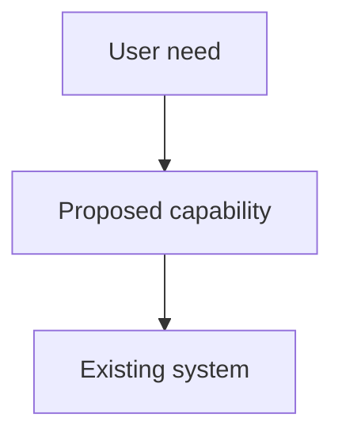

> **Adaptation:** Based on `mattpocock/skills`; adapted for portable Codex and Claude Code use and explicit tracker-publication authorization.

Synthesize existing conversation, wayfinder map, or codebase context into a standalone spec (PRD). Do not interview the user or require seam confirmation. Carry every known requirement, invariant, and proposed default into the artifact. Unknown required behavior or invariants remain explicit unresolved decisions; a recommendation is a proposal until accepted. Use the template contracts below to represent readiness and open decisions.

Inspect existing tracker configuration and triage vocabulary read-only. If setup is missing, continue the local spec and prepare the required setup proposal. Any configuration, credential, or external-state mutation requires applicable authorization before execution. Skill invocation itself does not grant that permission.

## Output

Write the spec as a standalone `.mdx` artifact, not a `.md` file.

**Save specs to:** `docs/superpowers/specs/YYYY-MM-DD-<feature-name>.mdx`
- User preferences for spec location override this default, but the file extension stays `.mdx`.

The `.mdx` file is the durable source of truth; the project issue tracker is its publication and coordination surface. Publication follows the authorization gate in the process below.

## Agent-Native MDX Discipline

Treat the spec as a reviewable artifact, not chat-only prose. The `.mdx` file must stand alone for a reader who never saw the chat, source discussion, wayfinder map, or prior drafts.

- **Lead with context.** Explain the problem, destination, scope, and user impact before implementation detail.
- **Use MDX blocks only when useful.** Plain Markdown is valid MDX. Add diagrams, file maps, decision tables, callouts, or review surfaces when they make the spec easier to read.
- **Keep it user-readable.** Prefer short sections, tables for comparisons, and Mermaid diagrams for relationships. Avoid dumping implementation minutiae into prose.
- **No revision memos.** If adapting an existing `.md`, issue body, or pasted draft, publish a clean standalone `.mdx` proposal. Do not write "unlike the previous version" or "preserve prior spec".

### Useful MDX Sections

Use these sections when they improve review. Skip empty sections.

````mdx
## System Context



## Decision Log

| Decision | Choice | Why | Source |
| --- | --- | --- | --- |
| Storage boundary | Existing domain store | Reuses current ownership model | [Decision ticket](...) |

## File Map

| Area | Existing surface | Expected change |
| --- | --- | --- |
| Backend API | `backend/...` | Add endpoint contract |
````

## Process

1. Inspect only missing context needed to describe the current system. Use the project domain glossary and respect applicable ADRs. Reuse prior exploration.

2. If the project maintains an implementation-findings or recurring-gaps log, check it for past issues in this area. Address recurring failures explicitly as requirements, constraints, or open questions. If a relevant log is unavailable, disclose that limit.

3. Gather planning artifacts for the template's `## Related Work` contract. Select existing test seams at the highest useful boundary; propose a new seam only where existing ones cannot verify required behavior. Use as few seams as needed. Record unresolved seam choices in Open Questions and continue drafting.

4. Write the `.mdx` using the template, including its requirements, invariants, executor, status, and open-decision contracts. Continue the draft while decisions or publication remain blocked.

5. Self-review before any publication. Verify `.mdx` extension, standalone context, complete template obligations and Related Work, no unresolved placeholders, and valid Markdown-compatible MDX, Mermaid, and tables. Trace known requirements, invariants, unknowns, and proposed defaults from context to the artifact; check acceptance drafts and testing decisions. Verify status, executor selection, and intended tracker labels against the template contracts.

6. Publish only when existing session authorization and applicable permissions allow tracker writes. Create or update the relevant spec issue and link the `.mdx`. Make `ready-for-agent` reflect the template status: apply it only for Ready for planning; remove it from a blocked draft when authorized. No additional triage is needed. If approval is required or tracker access/configuration is missing, deliver the reviewed local spec, prepared issue content, and concrete setup or publication proposal; report the pending action and request only the missing authorization or setup information. Already authorized actions need no repeated permission request. The skill does not grant tracker-write or setup-mutation permission.

<spec-template>

# <Feature Name> Spec

> **For agentic workers:** This `.mdx` spec is the source of truth. Preserve the `## Related Work` links when creating plans or tickets from it.
>
> **Downstream execution:** State the executor selected explicitly by the user or applicable project instructions. If none is selected, write "Executor selection pending in planning."

**Goal:** <one sentence describing what this spec enables>

**Status:** State "Ready for planning" only when remaining questions do not block safe, testable planning. Otherwise write "Draft - blocked" and identify the blocking Open Questions. Unknown required invariants, unresolved requirements that prevent acceptance criteria, and unaccepted defaults needed to settle those decisions are blockers. Nonblocking executor selection or tracker setup remains explicitly pending without inventing a decision.

---

## Problem Statement

The problem that the user is facing, from the user's perspective.

## Related Work

Link the wayfinder map, decision tickets, predecessor/sibling specs, downstream plans, and ticket sets that frame this spec. State whether this spec splits, supersedes, depends on, or continues them. Identify the expected downstream plan or ticket split even if it does not exist yet. Use links and decision gists rather than restating ticket bodies.

For a wayfinder-derived spec, include:

- The wayfinder map.
- Every closed decision ticket that materially shaped the spec, each with a one-line decision gist.
- Any open or out-of-scope ticket that explains a boundary of this spec.

For a non-wayfinder spec, include related specs/plans/tickets if they exist. If none exist, write "None."

## Solution

The solution to the problem, from the user's perspective.

## Requirements Draft

Atomic obligations this spec imposes. Each requirement should be independently verifiable. The downstream plan will refine these into a formal Requirements Inventory with `REQ-NNN` identifiers, acceptance oracles, and task mappings.

| # | Type | Obligation | Acceptance (draft) |
| --- | --- | --- | --- |
| R1 | behavior | <what the system must do> | <how to verify> |
| R2 | constraint | <cross-cutting rule> | <objective check> |
| R3 | contract | <wiring between components> | <integration test or trace> |

Types: `behavior` (runtime behavior), `constraint` (cross-cutting rule), `contract` (cross-component wiring), `test` (test the plan promises to add).

If no requirements can be stated yet, write "Deferred to planning phase" with rationale.

## Invariants

List required properties that must always hold, including recovery, retries, data integrity, and other domain constraints supported by existing context. For each, record the agreed rule and observable verification. If the context leaves a required invariant unknown, include an explicit unknown entry linked to a blocking Open Question; retain any proposed default there with its rationale. Never turn an unknown or proposal into an agreed invariant.

## User Stories

A LONG, numbered list of user stories. Each user story should be in the format of:

1. As an <actor>, I want a <feature>, so that <benefit>

<user-story-example>
1. As a mobile bank customer, I want to see balance on my accounts, so that I can make better informed decisions about my spending
</user-story-example>

This list of user stories should be extremely extensive and cover all aspects of the feature.

## Implementation Decisions

List agreed implementation decisions here. Preserve unaccepted recommendations in Open Questions as proposed defaults with rationale. Agreed decisions can include:

- The modules that will be built/modified
- The interfaces of those modules that will be modified
- Technical clarifications from the developer
- Architectural decisions
- Schema changes
- API contracts
- Specific interactions

Do NOT include specific file paths or code snippets. They may end up being outdated very quickly.

Exception: if a prototype produced a snippet that encodes a decision more precisely than prose can (state machine, reducer, schema, type shape), inline it within the relevant decision and note briefly that it came from a prototype. Trim to the decision-rich parts — not a working demo, just the important bits.

## Testing Decisions

A list of testing decisions that were made. Include:

- **Test philosophy:** Tests must verify external behavior and invariants, not implementation details. Passing tests are evidence, not proof — the downstream spec-aware tester validates whether tests demonstrate stated philosophy and invariants.
- **Seams:** Which existing seams will be tested. Prefer existing seams to new ones; use the highest seam possible.
- **Invariant tests:** Which invariants from the spec require dedicated test cases beyond functional coverage. These are the tests that catch "green but wrong."
- **Prior art:** Similar test patterns already in the codebase to follow for consistency.
- **Modules under test:** Which modules will be tested and at what level (unit, integration, end-to-end).

## Out of Scope

A description of the things that are out of scope for this spec.

## Further Notes

Any further notes about the feature. Skip this section if empty.

## Open Questions

Place every unresolved architecture, UX, data shape, rollout, scope, test-seam, requirement, or invariant decision here, at the bottom. Preserve supplied proposed defaults and their rationale even when a decision remains blocked. A proposed default does not resolve a blocker until accepted.

| Question / unknown | Known constraints | Proposed default and rationale | Blocking? Why? | Resolution needed |
| --- | --- | --- | --- | --- |
| <unresolved decision> | <known facts> | <existing recommendation, or none established> | <yes/no and effect on planning> | <decision or evidence needed> |

Skip this section only when no unresolved decisions remain.

</spec-template>
